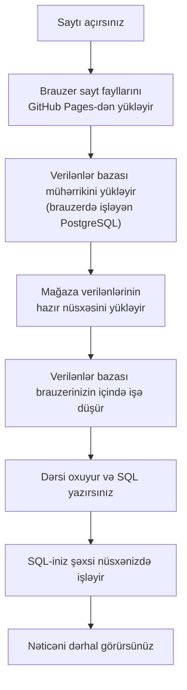
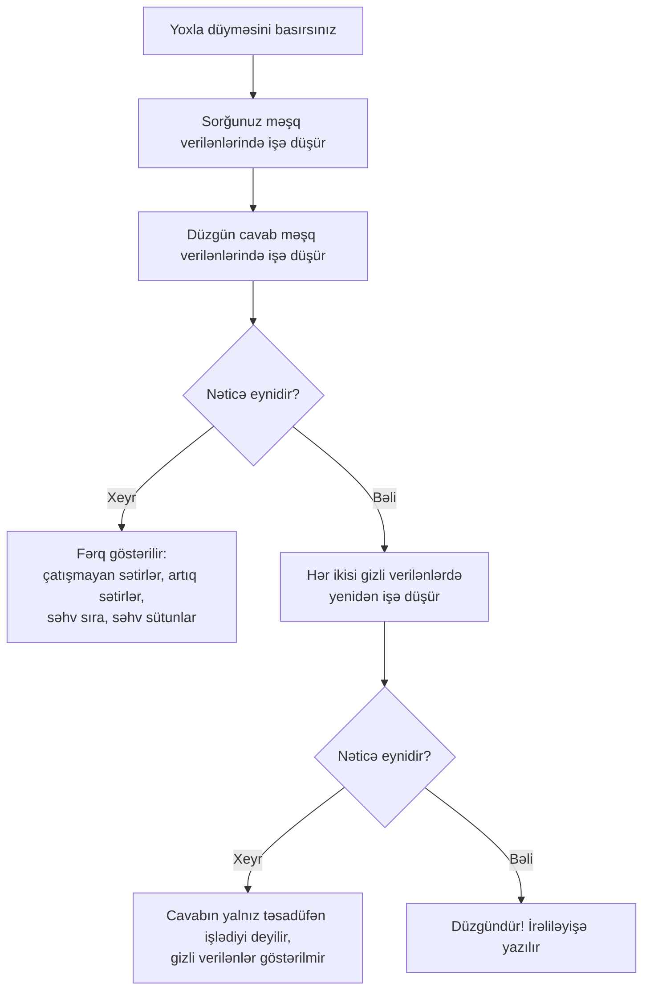
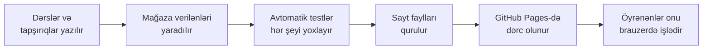
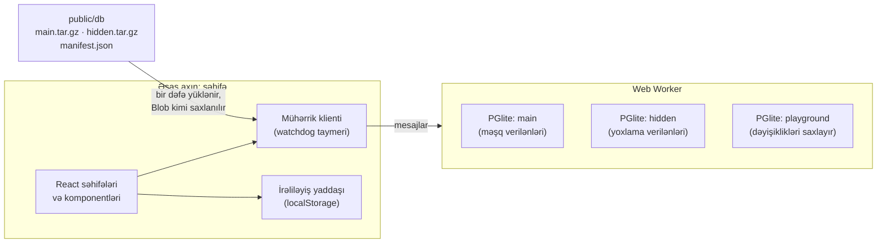
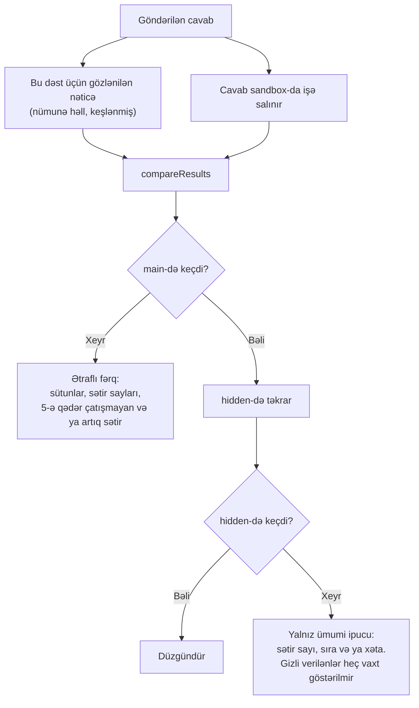
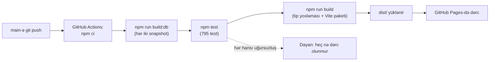

# PostgreSQL Bootcamp: Layihə bələdçisi

**Sayt:** https://matin-masimli.github.io/postgresql-bootcamp/
**Kod:** https://github.com/Matin-Masimli/postgresql-bootcamp

Bu bələdçi iki hissədən ibarətdir:

- **1-ci hissə** layihəni sadə sözlərlə, şəkillərlə izah edir. Hər kəs oxuyub başa düşə bilər.
- **2-ci hissə** texniki detallara girir ki, layihənin necə işlədiyi barədə istənilən suala cavab verə biləsiniz.

> Şəkillər Mermaid diaqramları kimi yazılıb. GitHub-da (bu faylı orada açın) onlar çəkilmiş sxem kimi görünür. Başqa redaktorlarda diaqramın mətnini görə bilərsiniz.

---

# 1-ci hissə: Sadə izah

## 1. Bu layihə nədir?

PostgreSQL Bootcamp **SQL**-i öyrədən pulsuz vebsaytdır. SQL verilənlər bazasına sual vermək üçün işlədilən dildir.

Burada siz edərək öyrənirsiniz:

1. Qısa dərs oxuyursunuz.
2. Sorğunu özünüz yazırsınız.
3. Sayt onu real verilənlər bazasında işə salır və dərhal cavabınızın düzgün olub-olmadığını, səbəbi ilə birlikdə deyir.

Ən sadədən mürəkkəbə qədər **21 dərs** və **339 tapşırıq** var.

## 2. Əsas ideya: verilənlər bazası brauzerinizin içində yaşayır

Adətən SQL məşq etmək üçün verilənlər bazası serveri lazımdır: haradasa verilənləri saxlayan və sorğuları işə salan kompüter. Bu, pul tələb edir, hesab açmaq lazım olur və xarab ola bilər.

Bu layihə başqa cür işləyir. **Tam, real PostgreSQL verilənlər bazası sizin veb brauzerinizin içində**, öz kompüterinizdə işləyir. Bu, səhifəni hər açanda mağazanın qeydlərinin kiçik, şəxsi nüsxəsini almaq kimidir.

Bu nə deməkdir:

- **Server yoxdur, giriş yoxdur, pulsuzdur.** Sayt sadəcə fayllardan ibarətdir.
- **Etdiyiniz heç nə başqası üçün heç nəyi xarab edə bilməz.** Hər ziyarətçinin öz nüsxəsi var.
- **Çox adam eyni vaxtda**, istənilən cihazda, bir-birini yavaşlatmadan işlədə bilər.
- **İrəliləyişiniz öz brauzerinizdə saxlanılır.** Onu fayla ixrac edib başqa cihazda idxal edə bilərsiniz.

## 3. Saytda nə var

| Səhifə | Nə üçündür |
|---|---|
| **Öyrən** (ana səhifə) | Sıra ilə 21 dərs və hər birində irəliləyişiniz |
| **Dərs səhifəsi** | İzah, işə salına bilən nümunələr və tapşırıqların siyahısı |
| **Tapşırıq səhifəsi** | Cavabınızı yazın, nəticəni görmək üçün **İcra et**, yoxlatmaq üçün **Yoxla** düyməsini basın |
| **Həllər kitabçası** | Dərsin bütün tapşırıqları həlləri və izahları ilə, çap üçün hazır |
| **Təkrar** | Bitirdiyiniz dərslərdən 10-a qədər qarışıq tapşırıq, əvvəlcə həll olunmamışlar |
| **İmtahan** | Vaxtlı test (standart olaraq 20 sual və 45 dəqiqə). İpucu yoxdur, bal sonda göstərilir |
| **Playground** | Verilənlər bazasının öz nüsxənizdə sərbəst məşq. Dəyişikliklər sıfırlayana qədər qalır |
| **Sxem** | Cədvəllərin siyahısı və onların necə əlaqələndiyinin diaqramı |
| **İrəliləyiş** | Nəyi həll etdiyiniz, aktiv günlər seriyanız, ixrac və idxal |

Dörd növ tapşırıq var:

- **Sorğu yaz:** cavabı sıfırdan qurun.
- **Sorğunu düzəlt:** səhv sorğu verilir, siz onu düzəldirsiniz.
- **Nəticəni təxmin et:** sorğunun hansı nəticə cədvəlini verəcəyini seçin.
- **Konsepsiya:** çoxseçimli sual.

## 4. Məşq verilənləri: onlayn mağaza

Bütün tapşırıqlar eyni uydurma şirkəti işlədir: müştəriləri, sifarişləri, məhsulları, ödənişləri, çatdırılmaları, qaytarmaları, rəyləri olan **onlayn mağaza**, üstəlik şirkətin **işçiləri** və onların maaşları. Cəmi **16 cədvəl** var.

Verilənləri proqram uydurur, amma real görünsün deyə hazırlanıb və real işdə insanları çaşdıran çətin halları gizlədir: çatışmayan dəyərlər, bərabərliklər, uzun ilin 29 fevralı, yay vaxtına keçid, təkrarlanan e-poçt ünvanları, boş departament və s.

Verilənlərdə "bu gün" həmişə **30 iyun 2025**-dir, ona görə də tapşırığı nə vaxt etməyinizdən asılı olmayaraq hər cavab eyni qalır.

## 5. Şəkil 1: saytı açanda nə baş verir



İlk ziyarətdə təxminən 20 MB yüklənir (mühərrik və verilənlər). Sonra brauzer onu yadda saxlayır, ona görə də sonrakı ziyarətlər xeyli tez açılır.

## 6. Şəkil 2: "Yoxla" düyməsini basanda nə baş verir

Yoxlayıcı sadəcə cavabınızın mətninə baxmır. O, cavabınızı **işə salır** və nəticəni düzgün cavabın verdiyi nəticə ilə müqayisə edir.

Ağıllı hissə budur: o, sizi **iki fərqli verilənlər dəsti** üzərində yoxlayır. Birincisi sizin gördüyünüzdür. İkincisi **gizli** dəstdir: cədvəllər eynidir, sətirlər isə fərqli. Ona görə də yalnız təsadüfən işləyən və ya ekranda gördüyünüz dəqiq ədədləri yazmaqla işləyən cavab tutulur.



Hər İcra et və ya Yoxla əməliyyatından sonra verilənlər bazası **tam əvvəlki vəziyyətinə qaytarılır**, ona görə də hər cəhd təmiz başlayır. (Dəyişikliklərin qaldığı yeganə yer Playground-dur.)

## 7. Şəkil 3: layihə necə qurulur və dərc olunur



GitHub-a hər dəyişiklik yüklənəndə robot (GitHub Actions) bütün bu zənciri özü təkrarlayır. **Hər hansı** test uğursuz olsa, heç nə dərc olunmur, ona görə də səhv tapşırıq heç vaxt canlı sayta düşə bilməz.

## 8. Onu addım-addım necə qurduq

1. **Boş layihəni hazırladıq:** saytın skeleti və alətlər.
2. **Verilənləri yaratdıq:** 16 cədvəli layihələndirdik, mağaza verilənlərini uyduran proqramı yazdıq və çətin halların həqiqətən mövcud olduğunu yoxlayan testlər əlavə etdik.
3. **Saytın əsasını qurduq:** naviqasiya, diaqramlı sxem səhifəsi və yüklənmə sürətini ölçən səhifə.
4. **Yoxlayıcını qurduq:** istənilən SQL-in təhlükəsiz işə salınması, nəticələrin müqayisəsi və aydın rəy.
5. **Öyrənmə səhifələrini qurduq:** tapşırıqlar, həllər kitabçası, təkrar, imtahan, playground və irəliləyiş.
6. **Kursu yazdıq:** 21 dərs və 339 tapşırıq. Hər tapşırığın düzgün cavabı, qəbul olunan digər cavabları və testlərin rədd edildiyinə əmin olduğu tipik **səhv** cavabları var.
7. **GitHub Pages-də dərc etdik**, hər dəyişiklikdə avtomatik testlərlə.
8. **Dizaynı yenilədik:** müasir tünd görünüş, üstəlik verilənlər bazasının sorğuya addım-addım necə cavab verdiyini göstərən **sorğu vizualizatoru** əlavə etdik.
9. **Azərbaycan dilini əlavə etdik:** bütün interfeys, hər dərs və hər tapşırıq. SQL, cədvəl adları və funksiya adları ingiliscə saxlanıldı.

## 9. İki dil

Hər səhifənin yuxarısında **EN** və **AZ** arasında keçid edə bilərsiniz. Oxuduğunuz hər şey tərcümə olunub: menyular, dərslər, tapşırıqlar, ipucları və yoxlayıcının mesajları.

Qəsdən ingiliscə saxlananlar: SQL-in özü, cədvəl və sütun adları, funksiya adları. Siz məhz bunları yazırsınız, ona görə də onlar real verilənlər bazası ilə üst-üstə düşməlidir.

Hər iki dil **eyni** düzgün cavabları və **eyni** yoxlayıcını işlədir, ona görə də tapşırığı hansı dildə oxumağınızdan asılı olmayaraq qiymətləndirmə eynidir.

## 10. Nə harada saxlanılır

| Nə | Harada | Nə qədər |
|---|---|---|
| Həll olunmuş tapşırıqlar, cəhdlər, qaralamalar, imtahan balları | Brauzeriniz (local storage) | Siz təmizləyənə qədər. İxrac və idxal edə bilərsiniz |
| Dil və tema seçimi | Brauzeriniz | Eyni |
| Playground dəyişiklikləri | Brauzerin yaddaşı | Sıfırlayana və ya səhifəni yeniləyənə qədər |
| Serverdə nəsə | Heç yerdə | Server yoxdur |

---

# 2-ci hissə: Texniki təfərrüatlar

## 11. Texnologiyalar

| Hissə | Alət | Niyə |
|---|---|---|
| Verilənlər bazası | **PGlite 0.5.10** (WebAssembly-yə kompilyasiya olunmuş PostgreSQL 18.6) | Brauzerdə işləyən təqlid yox, real PostgreSQL |
| İnterfeys | **React 19**, **TypeScript**, **React Router** (hash routing) | Tipli, komponentlərə əsaslanan UI |
| Dizayn | **Tailwind CSS 4** | Sürətli, ardıcıl üslub, tünd və açıq tema |
| SQL redaktoru | **CodeMirror 6** | Sintaksis rəngləmə, xətanın altından xətt çəkmə, klaviatura qısayolları |
| Dərslər | **react-markdown** + GFM | Dərslər Markdown-da yazılıb (cədvəllər, kod blokları) |
| Validasiya | **zod** | Hər tapşırıq və saxlanılan irəliləyiş sxemə qarşı yoxlanılır |
| Qurma | **Vite 8** | İnkişaf serveri və istehsal paketi |
| Testlər | **Vitest** (795 test) | Keyfiyyət yoxlaması |
| Hostinq | **GitHub Pages** + **GitHub Actions** | Pulsuz statik hostinq, avtomatik dərc |

## 12. Qovluq xəritəsi

```text
PostgreSQL_project/
├── content/                 kurs
│   ├── topics/              21 dərs faylı (ingiliscə, əsas mənbə)
│   ├── az/                  Azərbaycan dilinə tərcümə (yalnız mətn)
│   │   ├── topics/          21 tərcümə olunmuş dərs faylı
│   │   ├── meta.ts          mövzu adları və xülasələri
│   │   └── schema.ts        cədvəl və sütun təsvirləri
│   ├── types.ts             mövzu və suallar üçün zod sxemləri
│   ├── helpers.ts           DDL/DML yoxlanışı üçün hazır bloklar
│   ├── i18n.ts              tərcüməni ingiliscə məzmunun üzərinə qoyur
│   ├── index.ts             bütün mövzu və sualların reyestri
│   └── topicList.ts         21 mövzunun id-ləri, slug-ları və sırası
├── scripts/
│   ├── db/                  schema.sql, verilənlər generatoru, kənar hal yoxlamaları, snapshot qurucusu
│   ├── sql.ts               terminaldan sorğunu hər iki dəstdə işə salmaq
│   └── check-links.ts       hər mənbə linkini yoxlamaq
├── src/
│   ├── db/                  PGlite-ı saxlayan Web Worker + əsas axın klienti (watchdog)
│   ├── engine/              sandbox, əmr bölücü, qiymətləndirici, nəticə müqayisəsi, plan modeli
│   ├── components/          redaktor, nəticə cədvəlləri, rəy, vizualizator, ER diaqramı…
│   ├── pages/               hər səhifə üçün bir fayl (10 səhifə)
│   ├── i18n/                en.ts və az.ts lüğətləri, dil yaddaşı, məzmun yükləyicisi
│   ├── lib/                 manifest, tema, sessiya köməkçiləri, vizualizator
│   └── progress/            irəliləyiş yaddaşı (localStorage, ixrac/idxal)
├── tests/                   keyfiyyət yoxlaması (6 test faylı)
├── public/db/               yaradılan verilənlər bazası snapshot-ları (commit olunmur)
├── docs/                    bu bələdçi + mühərrik qeydləri
└── .github/workflows/       qurma, test və dərc boru xətti
```

## 13. Arxitektura



- **Verilənlər bazası Web Worker-də**, yəni fon axınında işləyir, ona görə də yavaş sorğu heç vaxt səhifəni dondurmur.
- Worker **üç verilənlər bazası nüsxəsinə** qədər saxlayır: `main` (məşq verilənləri), `hidden` (yoxlama verilənləri, ilk Yoxla zamanı yüklənir və `main` hazır olan kimi əvvəlcədən yüklənməyə başlayır) və `playground` (dəyişiklikləri saxlanılan, məşq verilənlərinin ayrıca nüsxəsi).
- **Watchdog.** PGlite `statement_timeout`-u nəzərə almır, ona görə də sonsuz sorğu (sonsuz rekursiv CTE, nəhəng cross join) içəridən dayandırıla bilməz. Klient hər sorğuya vaxt limiti verir: İcra et üçün 10 s, Yoxla üçün 20 s, daxili sorğular üçün 15 s, verilənlər bazasını açmaq üçün 120 s. Limit aşılanda klient **worker-i dayandırır** və yaddaşda saxladığı snapshot fayllarından yenisini başladır. Playground sıfırlandığı barədə bildiriş göstərir.
- Worker-də sorğular **ciddi şəkildə bir-bir** işləyir, çünki hər sandbox işi öz `BEGIN … ROLLBACK`-ına güvənir.

## 14. Məşq verilənləri

**Sxem** (`scripts/db/schema.sql`), 16 cədvəl:

- Mağaza: `customers`, `orders`, `order_items`, `payments`, `shipments`, `returns`, `reviews`, `products`, `categories` (`parent_id` vasitəsilə ağac), `suppliers`, `countries`.
- Şirkət: `departments`, `employees` (`manager_id` vasitəsilə iyerarxiya), `salary_history`.
- Digər: `user_logins`, `staging_customer_import` (qəsdən qarışıq).

Hər cədvəlin və onun vacib sütunlarının təsviri var (37 `COMMENT ON` əmri), Sxem səhifəsi onları göstərir (AZ-da tərcümə olunub).

**Generator** (`scripts/db/generate.ts`):

- Deterministikdir: eyni seed həmişə bayt-bayt eyni verilənləri yaradır. `Math.random()`, real saat və ya regional funksiyalar işlədilmir.
- İki verilənlər dəsti (`scripts/db/datasets.ts`):

| Dəst | Seed | Ölçü | Sətir sırası |
|---|---|---|---|
| `main` | `atlas-main-v1` | miqyas 1, təxminən 59 min sətir | təbii |
| `hidden` | `atlas-hidden-v1` | miqyas 0.6, təxminən 36 min sətir | fiziki olaraq qarışdırılıb |

  Gizli dəstin qarışdırılmış sətir sırası sətirlərin "təsadüfən" əlavə olunma sırası ilə qayıtmasına güvənən cavabları tutur.
- **Qəsdən qoyulmuş kənar hallar** generatorda `EDGE:` kimi işarələnib, məsələn: qiymət və maaşlarda bərabərliklər, istəyə bağlı sütunlarda NULL-lar, 29 fevral 2024-də və yay vaxtı keçidlərində verilmiş sifarişlər, *Shoes* adlı iki kateqoriya, boş departament, 2024-də işdən çıxmış menecer, uzun il gününü keçən 21 günlük giriş seriyası.
- **74 SQL yoxlaması** (`scripts/db/edge-cases.ts`) yükləmədən sonra **hər iki** dəstdə işləyir. Hər hansı kənar hal yoxdursa və ya verilənlər uyğunsuzdursa (məsələn, sifariş cəmləri düz gəlmirsə), qurma uğursuz olur.

**Snapshot-lar** (`scripts/db/build-snapshots.ts`, `npm run build:db` ilə işə salınır):

1. Verilənlər yaradılır, Node-da PGlite-a yüklənir, `timezone = 'UTC'` və `datestyle = 'ISO, YMD'` təyin olunur, yoxlamalar işə salınır.
2. Verilənlər qovluğu kiçildilir: `template0`/`template1` silinir və WAL təkrar emal olunur. Boş baza 4.5 MB-dan sıxılmış halda təxminən 1 MB-a düşür.
3. `public/db/main.tar.gz` (təxminən 3.3 MB), `hidden.tar.gz` (təxminən 2.7 MB) və `manifest.json` (cədvəllər, sütunlar, məhdudiyyətlər və sequence başlanğıc dəyərləri; Sxem səhifəsi və sandbox onu işlədir) yazılır.

Snapshot-lar git-ə commit olunmur. CI onları hər qurmada yenidən yaradır.

## 15. Sandbox: istənilən SQL-in təhlükəsiz işə salınması

`src/engine/session.ts` (`PracticeSession`) və `src/engine/sqlScan.ts`:

1. Göndərilən mətn əmrlərə **bölünür**. Bölücü dırnaqları, dollar dırnaqlarını (`$$ … $$`) və iç-içə şərhləri nəzərə alır.
2. Sandbox-u poza biləcək şeylər **rədd edilir**: tranzaksiya idarəsi (`BEGIN`, `COMMIT`, `ROLLBACK`…) və tranzaksiya daxilində işləyə bilməyən əmrlər (`VACUUM`, `CREATE DATABASE`…). Mesaj əvəzində Playground-u təklif edir.
3. `BEGIN`, sonra **identity sequence-lər** snapshot dəyərlərinə **sıfırlanır**. Sequence-lər tranzaksiyaya tabe deyil, bu olmasa `INSERT` hər cəhddə fərqli id-lər alardı.
4. Əmrlər **bir-bir** işə salınır və ilk xətada dayanır. Xətanın mövqeyi redaktora ötürülür və dəqiq yerin altından xətt çəkilir.
5. Sətir qaytaran əmrlər **kursor** vasitəsilə oxunur (`DECLARE … NO SCROLL CURSOR` + `FETCH 50001`). 5 milyon sətirlik nəticə tabı çökdürə bilməz: qiymətləndirmə üçün ən çox 50 000, göstərmək üçün isə 500 sətir saxlanılır.
6. DDL/DML tapşırıqları üçün eyni tranzaksiyada **yoxlama sorğusu** işləyir (17-ci bölməyə baxın).
7. `ROLLBACK`. Verilənlər bazası yenidən təmizdir.

Nəticələr hər tip üçün PostgreSQL-in öz mətni kimi qayıdır (hər tip oid-i üçün identity parser), ona görə də `true` `t` kimi, array-lər `{1,2}` kimi, vaxt dəyərləri ISO formatında göstərilir, eynilə `psql`-də olduğu kimi.

## 16. Qiymətləndirmə

`src/engine/grade.ts` və `src/engine/compare.ts`:



Hər tapşırığın müqayisəni idarə edən `checkConfig`-i var:

| Ayar | Mənası |
|---|---|
| `orderMatters` | Sətirlər eyni sırada olmalıdır (tapşırıq sıralama tələb edir). Əks halda sətirlər multiset kimi müqayisə olunur |
| `columnNamesMatter` | Yalnız dəyərlər yox, sütun adları da uyğun gəlməlidir |
| `duplicatesMatter` | Multiset (dublikatlar sayılır) və ya set müqayisəsi |
| `numericTolerance` | Ədədlər üçün icazə verilən fərq (əks halda 1e-9 kiçik nisbi tolerantlıq) |
| `allowSameOnHidden` | Nümunə həllə hər iki dəstdə eyni nəticə qaytarmağa icazə verir (adətən qadağandır, 18-ci bölməyə baxın) |

Ədədlər ədəd kimi müqayisə olunur (`1.0` `1`-ə bərabərdir), NULL NULL-a bərabərdir, boolean-lar normallaşdırılır. Nümunə həllin nəticəsi hər dəst üçün keşlənir, ona görə də ikinci Yoxla daha sürətlidir.

**Nəticəni təxmin et** sualları hər variantın hazır cədvəlini real nəticə ilə müqayisə edir. **Konsepsiya** sualları sadəcə seçilmiş variantı müqayisə edir.

## 17. DDL və DML-in davranışa görə yoxlanması

`CREATE TABLE`, `ALTER`, `INSERT`, `UPDATE`… üçün müqayisə ediləcək nəticə cədvəli yoxdur və eyni şeyi yazmağın bir çox düzgün yolu var (`CHECK (x > 0)` və `CHECK (0 < x)` eyni mənanı verir). Ona görə də yoxlayıcı əmrlərinizdən sonra **verilənlər bazasının nə etdiyini** test edir (`content/helpers.ts`):

- `columnsShape`: kataloqdan hər sütunun adını, tipini, NOT NULL-unu, standart dəyərini, identity və generated statusunu oxuyur.
- `keysShape`: primary, unique və foreign key-lər, sütunlarına görə (məhdudiyyət adlarının əhəmiyyəti yoxdur).
- `attemptsShape`: bir sıra test əmrlərini sınayır (NULL əlavə etmək, dublikat əlavə etmək, istinad edilən sətri silmək…) və hər birinin nəticəsini, `ok` və ya SQLSTATE xəta kodunu qeyd edir.

Sizin verilənlər bazanızdan çıxan yoxlama nəticəsi nümunə həllinki ilə, adi nəticə cədvəli kimi müqayisə olunur. Çatışmayan `NOT NULL`, səhv `ON DELETE` hərəkəti və ya çox boş `CHECK` fərqli sətir verir, ona görə də tutulur.

## 18. Məzmun modeli və keyfiyyət yoxlaması

Hər tapşırıq zod ilə yoxlanılan tipli obyektdir (`content/types.ts`):

- `id`, `topic`, `difficulty`, `type`, `title`, `prompt`, `hints`, `explanation`, `commonMistakes`, `relatedTopics`;
- sorğu tapşırıqları üçün: `referenceSolution`, `alternativeSolutions`, `wrongAnswers`, `starterSql` (düzəltmə), `verificationQuery` (DDL/DML) və `checkConfig`;
- təxmin və konsepsiya tapşırıqları üçün: `options` və `correctOption`.

`npm test` (795 test) **keyfiyyət yoxlamasıdır**. O keçməsə, heç nə dərc olunmur:

| Test faylı | Nəyə zəmanət verir |
|---|---|
| `generator.test.ts` | Generator deterministikdir, main və hidden verilənlər həqiqətən fərqlidir, ortaq istinad cədvəlləri eynidir, sətir həcmləri planlaşdırıldığı kimidir və snapshot-lar generatora uyğundur. (74 kənar hal yoxlaması daha əvvəl, `npm run build:db`-də işləyir və hər hansı biri yanlışdırsa, uğursuz olur.) |
| `checker.test.ts` | Sandbox, əmr bölücü, kursor limitləri və müqayisə qaydaları düzgün işləyir |
| `quality-gate.test.ts` | **Hər** tapşırıq üçün: struktur düzgündür; nümunə həll hər iki dəstdə işləyir, sətir qaytarır və gizli verilənlərdə **fərqli** nəticə verir (ona görə də cavabı sabit yazmaq mümkün deyil); hər alternativ keçir; **sadalanan hər səhv cavab uğursuz olur**; sıralı tapşırıqlarda `ORDER BY` var; qeyri-deterministik funksiyalar yoxdur; təxmin variantlarından düz biri uyğun gəlir; hər dərs nümunəsi işləyir |
| `plan.test.ts` | Vizualizatorun plan təhlili və bənd aşkarlanması |
| `progress.test.ts` | İrəliləyişin saxlanması, idxal, birləşdirmə və seriyalar |
| `i18n.test.ts` | Tərcümələr yalnız mətni dəyişir (20-ci bölməyə baxın) |

## 19. Sorğu vizualizatoru

Tapşırıqda və ya Playground-da **Vizuallaşdır** düyməsini basın (`src/lib/visualize.ts`, `src/engine/plan.ts`, `src/components/QueryVisualizer.tsx`):

1. Redaktordakı **son əmr** sandbox-da `EXPLAIN (ANALYZE, BUFFERS OFF, FORMAT JSON)` altında işləyir. Playground-da verilənləri dəyişən əmrlər yalnız planlaşdırılır, icra olunmur, ona görə də vizualizator verilənlərinizi heç vaxt dəyişmir.
2. JSON plan qovşaqlardan (scan, join, aggregate, sort…) ibarət **ağaca** çevrilir, hər birində real sətir sayları, vaxt və join şərti və ya filtr kimi detallar var.
3. Ayrıca, əmrin yuxarı səviyyəli bəndləri SQL-in **məntiqi sırası** ilə düzülür: FROM → WHERE → GROUP BY → HAVING → window → SELECT → DISTINCT → ORDER BY → LIMIT, sətir sayları plandan götürülür. Bu, məsələn, `SELECT` alias-ının niyə `WHERE`-də işlədilə bilmədiyini öyrədir.

## 20. İki dil (i18n)

**İnterfeys mətni** (`src/i18n/`):

- `en.ts` əsas lüğətdir. `az.ts` **hər** açarı təmin etməlidir: biri çatışmırsa, TypeScript qurmanı rədd edir.
- Azərbaycan qrammatikası üçün qeydlər funksiya ola bilər. Məsələn, köməkçilər ahəng qanununa görə düzgün şəkilçini verir: *1-ci, 3-cü, 6-cı, 9-cu*.
- Yoxlayıcı və mühərrik heç vaxt hazır cümlə yaratmır. Onlar mesaj açarı və parametrlər qaytarır (`{ key: 'fb.hiddenRowsCount', params: { expected, actual } }`), səhifə isə onu tərcümə edir. PostgreSQL-in öz xəta mesajları ingiliscə qalır, çünki öyrənənlər real həyatda məhz onları görəcək.
- Seçilmiş dil `localStorage`-də (`pgb.lang`) saxlanılır.

**Kurs məzmunu** (`content/az/`):

- Tərcümə `TopicText`-dir: o, yalnız **mətni** əvəz edə bilər (başlıqlar, tapşırıq mətnləri, ipucları, izahlar, tipik səhvlər, mətn variantları).
- Hər SQL parçası, hər nümunə həll və hər yoxlama ayarı ingiliscə fayllardan gəlir, ona görə də **qiymətləndirmə hər iki dildə eynidir**.
- Azərbaycan paketi ayrıca fayl kimi lazım olanda yüklənir, ona görə də ingiliscə ziyarətçilər onu yükləmir.

**Tərcümə yoxlaması** (`tests/i18n.test.ts`) tərcümə aşağıdakıları edərsə, qurmanı uğursuz edir:

- sual, ipucu, tipik səhv və ya variant əlavə edir və ya itirir;
- hər hansı daxili kod parçasını (`belə`) dəyişir: kod parçalarının multiset-i eyni olmalıdır;
- `--` şərhlərini tərcümə etməkdən başqa kod blokunu dəyişir (`-- ERROR` işarəsi saxlanılmalıdır);
- dərsin başlıq strukturunu dəyişir;
- lüğət açarını buraxır və ya `{placeholder}` və ya `<tag>` itirir.

Cədvəl, sütun və funksiya adlarının tərcümə olunmamasına məhz belə zəmanət verilir.

## 21. İrəliləyiş, təkrar, imtahan və playground

- **İrəliləyiş** (`src/progress/store.ts`): `localStorage`-də `pgb.progress.v1` açarı altında saxlanılır və yüklənəndə zod ilə yoxlanılır. Hər tapşırıq üzrə cəhdləri, həll olunub-olunmadığını, ilk həll tarixini, son cəhdi, işlədilən ipucları, həllin açılıb-açılmadığını və qaralamanızı qeyd edir. Həmçinin aktiv günləri (seriya üçün) və imtahan nəticələrini saxlayır. İxrac JSON faylı verir. İdxal **əvəz edə** və ya **birləşdirə** bilər: həll olunmuş qalib gəlir, ən böyük cəhd sayı saxlanılır, ən yeni qaralama saxlanılır.
- **Təkrar**: **bitirilmiş** mövzulardan (sualların ən azı yarısı həll olunub) 10-a qədər təsadüfi tapşırıq, əvvəlcə həll olunmamışlar. Sessiya səhifə yenilənəndə qalır (`sessionStorage`).
- **İmtahan**: standart olaraq 20 sual və 45 dəqiqə (hər ikisi dəyişdirilə bilər). Əvvəlcə interview və hard suallar, sonra medium, sonra easy seçilir. İmtahan zamanı ipucu və həll yoxdur, cavablar səssizcə qiymətləndirilir, bal irəliləyişə yazılır.
- **Playground**: dəyişiklikləri **Bazanı sıfırla** düyməsinə qədər qalan üçüncü verilənlər bazası nüsxəsi. Orada tranzaksiyalara icazə var. SQL mətniniz `localStorage`-də saxlanılır.
- **Diaqnostika** (`#/diagnostics`): hər iki snapshot-u yeni worker-də yükləyir və brauzerinizdəki real yüklənmə vaxtlarını göstərir.

## 22. Qurma və dərc boru xətti



- İş axını: `.github/workflows/deploy.yml`. Pull request-lər eyni yoxlamaları dərc etmədən işə salır.
- Sayt **nisbi əsas yol** və **hash routing** (`#/topic/...`) işlədir, ona görə də heç bir server ayarı olmadan istənilən repozitoriya adı altında işləyir.

## 23. Əsas rəqəmlər

| | |
|---|---|
| Mövzular | 21 |
| Tapşırıqlar | 339 (4 növ, 4 çətinlik səviyyəsi) |
| Cədvəllər | 16 |
| Sətirlər | təxminən 59 min (main), təxminən 36 min (hidden) |
| Kənar hal yoxlamaları | 74 |
| Avtomatik testlər | 795 |
| Dillər | İngilis, Azərbaycan |
| İlk yükləmə | təxminən 17 MB mühərrik + təxminən 6 MB verilənlər (sonra keşlənir) |
| Vaxt limitləri | İcra et 10 s, Yoxla 20 s |
| Sətir limitləri | 500 sətir göstərilir, 50 000 sətir qiymətləndirilir |
| Server xərci | 0 |

## 24. Tez-tez verilən suallar

**Backend və ya server verilənlər bazası varmı?**
Xeyr. GitHub Pages yalnız statik faylları verir. Verilənlər bazası hər ziyarətçinin brauzerində işləyir.

**Çox adam eyni vaxtda işlədə bilərmi?**
Bəli, limitsiz. Hər ziyarətçinin öz şəxsi verilənlər bazası var, ona görə də bir-birinə təsir edə bilməzlər.

**İnternetsiz işləyirmi?**
İlk tam yükləmədən sonra fayllar brauzerin keşində olur, ona görə də adətən işləməyə davam edir. Amma bu, zəmanətli oflayn tətbiq deyil.

**İlk yükləmə niyə yavaşdır?**
PostgreSQL mühərriki təxminən 17 MB, üstəlik təxminən 6 MB verilənlərdir. Brauzer hər ikisini keşləyir, ona görə də sonrakı ziyarətlər sürətlidir.

**Kimsə heç vaxt bitməyən sorğu yazsa nə olar?**
Watchdog 10–20 saniyədən sonra fon worker-ini dayandırır və verilənlər bazasını snapshot-dan yenidən başladır. Səhifənin özü heç vaxt donmur.

**Öyrənən verilənləri silə bilərmi?**
Yalnız öz sandbox-unun içində, hər İcra et və ya Yoxla isə sonra geri qaytarılır. Playground-da dəyişikliklər yalnız sıfırlamaya və ya səhifə yenilənənə qədər qalır.

**Gizli verilənlər dəsti niyə lazımdır?**
Cavabın yalnız gördüyünüz sətirlərdə yox, ümumiyyətlə düzgün olduğuna əmin olmaq üçün. Sabit yazılmış id-lər, dəyərlər və ya tarixlər məşq verilənlərində keçir, gizli verilənlərdə isə uğursuz olur. Gizli verilənlər heç vaxt göstərilmir.

**Tapşırıqların özünün düzgün olduğunu necə bilirsiniz?**
Keyfiyyət yoxlaması hər tapşırığın nümunə həllini, alternativ həllərini və məlum səhv cavablarını hər iki dəstdə işə salır. Səhv cavab qəbul olunsa və ya düzgün cavab rədd edilsə, qurma uğursuz olardı.

**Verilənlər necə "real" görünür?**
Seed-li generator onları real nümunələrlə uydurur (alış-veriş saatları, qiymət diapazonları, noyabr və dekabr ətrafında mövsümi zirvələr) və qəsdən çətin hallar yerləşdirir. 74 yoxlama həmin halların mövcud olduğuna zəmanət verir.

**Yeni tapşırığı necə əlavə etmək olar?**
Onu `content/topics/`-dəki mövzu faylına nümunə həlli, alternativləri və bir neçə tipik səhv cavabı ilə əlavə edin. Sonra tərcüməsini `content/az/topics/`-ə əlavə edin, `npm test` işə salın və push edin. Yazarkən sorğuları hər iki dəstdə sınamaq üçün `npm run sql -- "<sorğu>"` işlədə bilərsiniz.

**Üçüncü dili necə əlavə edərdik?**
Hər açarı olan lüğət (`az.ts` kimi) və məzmun paketi (`content/az/` kimi) əlavə edin, dili `src/i18n/index.ts`-də qeydiyyata salın. Qalanını tərcümə yoxlaması yoxlayır.

**Brauzeri təmizləsəm, irəliləyiş hara gedir?**
İxrac etməmisinizsə, itir. Ehtiyat fayl saxlamaq üçün **İrəliləyiş → İrəliləyişi ixrac et** işlədin.

**İşlətmək nə qədər başa gəlir?**
Heç nə. Açıq repozitoriyalar üçün GitHub Pages hostinqi və GitHub Actions pulsuzdur.

## 25. Faydalı əmrlər

| Əmr | Nə edir |
|---|---|
| `npm ci` | Asılılıqları quraşdırır |
| `npm run build:db` | Hər iki verilənlər bazası snapshot-unu `public/db/`-yə yaradır |
| `npm run dev` | http://localhost:5173 ünvanında inkişaf serveri |
| `npm test` | Tam keyfiyyət yoxlamasını işə salır |
| `npm run build` | Tipləri yoxlayır və saytı `dist/`-ə qurur |
| `npm run preview` | İstehsal versiyasını lokal olaraq göstərir |
| `npm run sql -- "<sorğu>"` | Terminaldan sorğunu hər iki dəstdə işə salır |
| `npm run check:links` | Dərslərdəki hər mənbə linkini yoxlayır |
