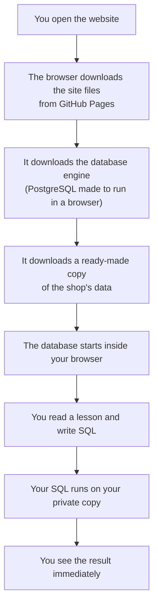
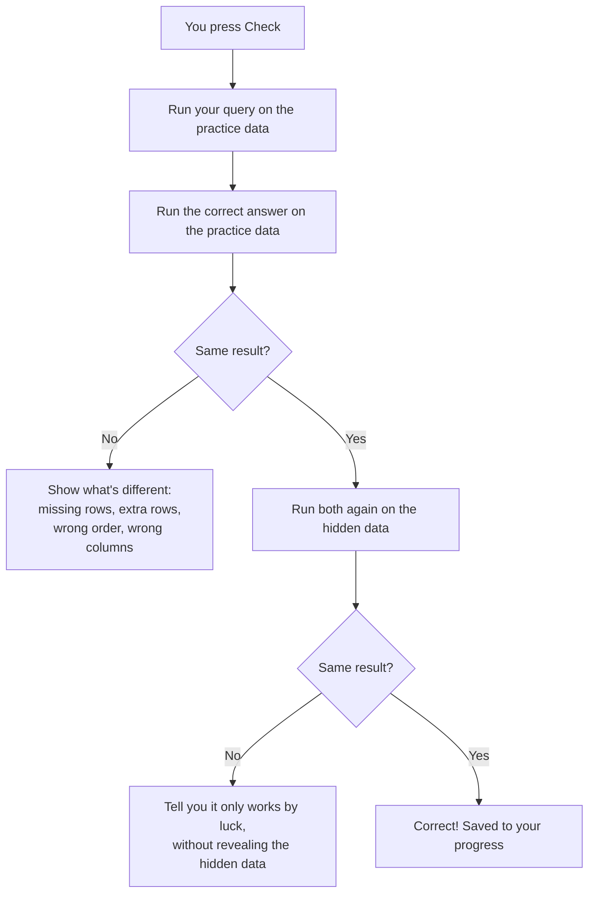
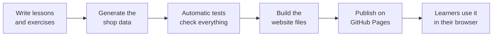
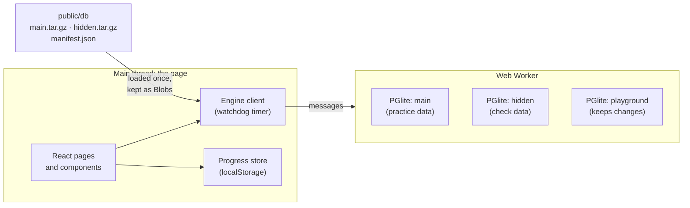
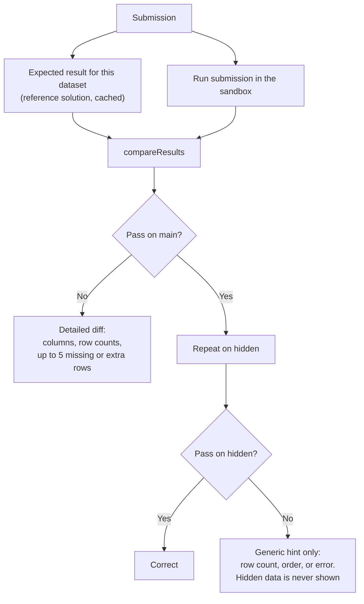
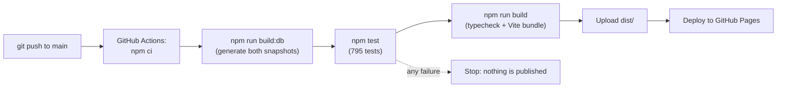

# PostgreSQL Bootcamp: Project Guide

**Live site:** https://matin-masimli.github.io/postgresql-bootcamp/
**Code:** https://github.com/Matin-Masimli/postgresql-bootcamp

This guide has two parts:

- **Part 1** explains the project in plain words, with pictures. Anyone can read it.
- **Part 2** goes into the technical details, so you can answer any question about how it works.

> The pictures are written as Mermaid diagrams. They show as drawings on GitHub (open this file there). In other editors you may see the diagram's text instead.

---

# Part 1: The simple explanation

## 1. What is this project?

PostgreSQL Bootcamp is a free website that teaches **SQL**, the language used to ask questions of a database.

You learn by doing:

1. You read a short lesson.
2. You write a query yourself.
3. The website runs it on a real database and tells you, straight away, whether your answer is right and why.

There are **21 lessons** (from the very basics up to advanced topics) and **339 exercises**.

## 2. The big idea: the database lives inside your browser

Normally, to practise SQL you need a database server: a computer somewhere that stores the data and runs your queries. That costs money, needs accounts and can break.

This project does it differently. **A complete, real PostgreSQL database runs inside your web browser**, on your own computer. It's like getting a small, private copy of the shop's records every time you open the page.

What this means:

- **No server, no login, no cost.** The website is just files.
- **Nothing you do can break anything for anyone else.** Every visitor has their own copy.
- **Many people can use it at the same time**, on any device, without slowing each other down.
- **Your progress is saved in your own browser.** You can export it to a file and import it on another device.

## 3. What's on the website

| Page | What it's for |
|---|---|
| **Learn** (home) | The 21 lessons in order, with your progress on each |
| **Lesson page** | The explanation, runnable examples and the list of exercises |
| **Exercise page** | Write your answer, press **Run** to see the result, press **Check** to have it graded |
| **Handbook** | Every exercise of a lesson with its solution and explanation, ready to print |
| **Review** | Up to 10 mixed exercises from lessons you've finished, unsolved ones first |
| **Exam** | A timed test (20 questions and 45 minutes by default). No hints, score at the end |
| **Playground** | Free practice on your own copy of the database. Changes are kept until you reset |
| **Schema** | The list of tables and a diagram of how they connect |
| **Progress** | What you've solved, your streak of active days, export and import |

There are four kinds of exercise:

- **Write a query:** build the answer from scratch.
- **Fix the query:** a broken query is given, and you repair it.
- **Predict the output:** choose which result table a query produces.
- **Concept:** a multiple-choice question.

## 4. The practice data: an online shop

All exercises use the same made-up company: an **online shop** with customers, orders, products, payments, deliveries, returns, reviews, plus the company's **employees** and their salaries. There are **16 tables** in total.

The data is invented by a program, but it's made to look real, and it hides the tricky cases that catch people out in real work: missing values, ties, a leap day (29 February), clock changes for summer time, duplicate e-mail addresses, an empty department, and so on.

"Today" in the data is always **30 June 2025**, so every answer stays the same no matter when you do the exercise.

## 5. Picture 1: what happens when you open the website



The first visit downloads about 20 MB (the engine plus the data). After that, the browser remembers it, so later visits start much faster.

## 6. Picture 2: what happens when you press "Check"

The checker doesn't just look at your answer's text. It **runs** your answer and compares what comes out with what the correct answer produces.

The clever part: it checks you on **two different sets of data**. The first is the one you can see. The second is a **hidden** one, with the same tables but different rows. So an answer that only works by luck, or by typing in exact numbers you saw on screen, gets caught.



After every Run or Check, the database is **put back exactly as it was**, so each attempt starts fresh. (The Playground is the one place where your changes are kept.)

## 7. Picture 3: how the project is built and published



Every time a change is uploaded to GitHub, a robot (GitHub Actions) repeats this whole chain by itself. If **any** test fails, nothing is published, so a broken exercise can never reach the live site.

## 8. How we built it, step by step

1. **Set up the empty project:** the website skeleton and the tools.
2. **Made the data:** designed the 16 tables, wrote the program that invents the shop's data, and added checks that the tricky cases really exist.
3. **Built the website shell:** navigation, the schema page with its diagram, and a page that measures loading speed.
4. **Built the checker:** safe running of any SQL, comparing results, and clear feedback.
5. **Built the learning pages:** exercises, handbook, review, exam, playground and progress.
6. **Wrote the course:** 21 lessons and 339 exercises. Each exercise comes with a correct answer, other accepted answers, and typical **wrong** answers that the tests make sure are rejected.
7. **Published it** on GitHub Pages, with automatic testing on every change.
8. **Redesigned it** with a modern dark look, and added the **query visualizer**, which shows step by step how the database answers a query.
9. **Added Azerbaijani:** the whole interface, every lesson and every exercise, while keeping SQL, table names and function names in English.

## 9. Two languages

You can switch between **EN** and **AZ** at the top of every page. Everything you read is translated: menus, lessons, exercises, hints and the checker's messages.

What stays in English on purpose: SQL itself, table and column names, and function names. Those are what you type, so they must match the real database.

Both languages use the **same** correct answers and the **same** checker, so an exercise is graded identically whichever language you read it in.

## 10. Where things are saved

| What | Where | How long |
|---|---|---|
| Solved exercises, attempts, drafts, exam scores | Your browser (local storage) | Until you clear it. You can export and import it |
| Language and theme choice | Your browser | Same |
| Playground changes | Your browser's memory | Until you reset or reload |
| Anything on a server | Nowhere | There is no server |

---

# Part 2: The technical deep dive

## 11. Technology

| Part | Tool | Why |
|---|---|---|
| Database | **PGlite 0.5.10** (PostgreSQL 18.6 compiled to WebAssembly) | A real PostgreSQL, not an imitation, running in the browser |
| User interface | **React 19**, **TypeScript**, **React Router** (hash routing) | Typed, component-based UI |
| Styling | **Tailwind CSS 4** | Fast, consistent styling, dark and light themes |
| SQL editor | **CodeMirror 6** | Syntax highlighting, error underlining, keyboard shortcuts |
| Lessons | **react-markdown** + GFM | Lessons are written in Markdown (tables, code blocks) |
| Validation | **zod** | Every exercise and the saved progress are checked against a schema |
| Build | **Vite 8** | Development server and production bundle |
| Tests | **Vitest** (795 tests) | The quality gate |
| Hosting | **GitHub Pages** + **GitHub Actions** | Free static hosting, automatic deploys |

## 12. Folder map

```text
PostgreSQL_project/
├── content/                 the course
│   ├── topics/              21 lesson files (English, the source of truth)
│   ├── az/                  Azerbaijani translation (prose only)
│   │   ├── topics/          21 translated lesson files
│   │   ├── meta.ts          topic titles and summaries
│   │   └── schema.ts        table and column descriptions
│   ├── types.ts             zod schemas for topics and questions
│   ├── helpers.ts           building blocks for DDL/DML verification
│   ├── i18n.ts              merges a translation over the English content
│   ├── index.ts             registry of all topics and questions
│   └── topicList.ts         the 21 topics' ids, slugs and order
├── scripts/
│   ├── db/                  schema.sql, data generator, edge-case assertions, snapshot builder
│   ├── sql.ts               run a query against both datasets from the terminal
│   └── check-links.ts       check every source link
├── src/
│   ├── db/                  Web Worker that hosts PGlite + the main-thread client (watchdog)
│   ├── engine/              sandbox, statement splitter, grader, result comparison, plan model
│   ├── components/          editor, result tables, feedback, visualizer, ER diagram…
│   ├── pages/               one file per page (10 pages)
│   ├── i18n/                en.ts and az.ts dictionaries, language store, content loader
│   ├── lib/                 manifest, theme, session helpers, visualizer runner
│   └── progress/            progress store (localStorage, export/import)
├── tests/                   the quality gate (6 test files)
├── public/db/               generated database snapshots (not committed)
├── docs/                    this guide + engine notes
└── .github/workflows/       build, test and deploy pipeline
```

## 13. Architecture



- **The database runs in a Web Worker**, a background thread, so a slow query never freezes the page.
- The worker holds up to **three database instances**: `main` (practice data), `hidden` (check data, loaded on the first Check and prefetched once `main` is ready) and `playground` (a separate copy of the practice data whose changes are kept).
- **The watchdog.** PGlite ignores `statement_timeout`, so a runaway query (an endless recursive CTE, a huge cross join) can't be cancelled from inside. The client gives each request a time limit: 10 s for Run, 20 s for Check, 15 s for internal queries, 120 s for opening a database. If it's exceeded, the client **terminates the worker** and starts a new one from the snapshot files it keeps in memory. The Playground shows a notice that it was reset.
- Requests run **strictly one at a time** in the worker, because every sandboxed run relies on its own `BEGIN … ROLLBACK`.

## 14. The practice data

**Schema** (`scripts/db/schema.sql`), 16 tables:

- Shop: `customers`, `orders`, `order_items`, `payments`, `shipments`, `returns`, `reviews`, `products`, `categories` (a tree via `parent_id`), `suppliers`, `countries`.
- Company: `departments`, `employees` (a hierarchy via `manager_id`), `salary_history`.
- Other: `user_logins`, `staging_customer_import` (deliberately messy).

Every table and its important columns have a description (37 `COMMENT ON` statements), which the Schema page displays (translated in AZ).

**Generator** (`scripts/db/generate.ts`):

- Deterministic: the same seed always produces byte-identical data. It uses no `Math.random()`, no wall clock and no locale functions.
- Two datasets (`scripts/db/datasets.ts`):

| Dataset | Seed | Size | Row order |
|---|---|---|---|
| `main` | `atlas-main-v1` | scale 1, about 59k rows | natural |
| `hidden` | `atlas-hidden-v1` | scale 0.6, about 36k rows | shuffled physically |

  The hidden data's shuffled row order catches answers that rely on rows "happening" to come back in insertion order.
- **Planted edge cases** are marked `EDGE:` in the generator, for example: ties in prices and salaries, NULLs in optional columns, orders on 29 February 2024 and at daylight-saving switches, two categories named *Shoes*, an empty department, a manager who left in 2024, a 21-day login streak across the leap day.
- **74 SQL assertions** (`scripts/db/edge-cases.ts`) run against **both** datasets after loading. The build fails if any edge case is missing or the data is inconsistent (for example if order totals don't add up).

**Snapshots** (`scripts/db/build-snapshots.ts`, run with `npm run build:db`):

1. Generate the data, load it into PGlite in Node, set `timezone = 'UTC'` and `datestyle = 'ISO, YMD'`, run the assertions.
2. Shrink the data directory: drop `template0`/`template1` and recycle the WAL. The empty baseline goes from 4.5 MB to about 1 MB gzipped.
3. Write `public/db/main.tar.gz` (about 3.3 MB), `hidden.tar.gz` (about 2.7 MB) and `manifest.json` (tables, columns, constraints and sequence baselines, used by the Schema page and the sandbox).

The snapshots aren't committed to git. CI regenerates them on every build.

## 15. The sandbox: running any SQL safely

`src/engine/session.ts` (`PracticeSession`) and `src/engine/sqlScan.ts`:

1. **Split** the submission into statements. The splitter respects quotes, dollar-quoting (`$$ … $$`) and nested comments.
2. **Reject** what would break the sandbox: transaction control (`BEGIN`, `COMMIT`, `ROLLBACK`…) and statements that can't run inside a transaction (`VACUUM`, `CREATE DATABASE`…). The message suggests the Playground instead.
3. `BEGIN`, then **reset identity sequences** to their snapshot values. Sequences aren't transactional, so without this an `INSERT` would get different ids on each try.
4. Run the statements **one by one**, stopping at the first error. The error position is mapped back to the editor, which underlines the exact spot.
5. Row-returning statements are read through a **cursor** (`DECLARE … NO SCROLL CURSOR` + `FETCH 50001`). A 5-million-row result can't crash the tab: at most 50,000 rows are kept for grading and 500 for display.
6. For DDL/DML exercises, a **verification query** runs in the same transaction (see section 17).
7. `ROLLBACK`. The database is pristine again.

Results come back as PostgreSQL's own text for every type (identity parsers for every type oid), so `true` shows as `t`, arrays as `{1,2}`, timestamps in ISO format, exactly as `psql` would show them.

## 16. Grading

`src/engine/grade.ts` and `src/engine/compare.ts`:



Each exercise has a `checkConfig` that controls the comparison:

| Setting | Meaning |
|---|---|
| `orderMatters` | Rows must be in the same order (the task specifies a sort). Otherwise rows are compared as a multiset |
| `columnNamesMatter` | Column names must match, not just values |
| `duplicatesMatter` | Multiset (duplicates count) or set comparison |
| `numericTolerance` | Allowed difference for numbers (otherwise a tiny relative tolerance of 1e-9) |
| `allowSameOnHidden` | Lets the reference return the same result on both datasets (normally forbidden, see section 18) |

Numbers are compared numerically (`1.0` equals `1`), NULL equals NULL, and booleans are normalised. The reference solution's result is cached per dataset, so a second Check is faster.

**Predict-the-output** questions compare each option's literal table with the real result. **Concept** questions simply compare the chosen option.

## 17. Checking DDL and DML by behaviour

For `CREATE TABLE`, `ALTER`, `INSERT`, `UPDATE`… there's no result table to compare, and there are many correct ways to write the same thing (`CHECK (x > 0)` and `CHECK (0 < x)` mean the same). So the checker tests **what the database does** after your statements (`content/helpers.ts`):

- `columnsShape`: reads every column's name, type, NOT NULL, default, identity and generated status from the catalog.
- `keysShape`: primary, unique and foreign keys, by their columns (constraint names don't matter).
- `attemptsShape`: tries a series of test statements (insert a NULL, insert a duplicate, delete a referenced row…) and records `ok` or the SQLSTATE error code each one raised.

The verification output from your database is compared with the reference solution's, exactly like a normal result table. A missing `NOT NULL`, a wrong `ON DELETE` action or a too-loose `CHECK` gives a different row, so it's caught.

## 18. The content model and the quality gate

Every exercise is a typed object (`content/types.ts`), validated with zod:

- `id`, `topic`, `difficulty`, `type`, `title`, `prompt`, `hints`, `explanation`, `commonMistakes`, `relatedTopics`;
- for query exercises: `referenceSolution`, `alternativeSolutions`, `wrongAnswers`, `starterSql` (fix-query), `verificationQuery` (DDL/DML) and `checkConfig`;
- for predict and concept exercises: `options` and `correctOption`.

`npm test` (795 tests) is the **quality gate**. Nothing is published unless it passes:

| Test file | What it guarantees |
|---|---|
| `generator.test.ts` | The generator is deterministic, the main and hidden data really differ, shared reference tables are identical, row volumes are as planned, and the snapshots match the generator. (The 74 edge-case assertions run earlier, in `npm run build:db`, which fails if any is false.) |
| `checker.test.ts` | The sandbox, statement splitter, cursor limits and comparison rules behave correctly |
| `quality-gate.test.ts` | For **every** exercise: the shape validates; the reference runs on both datasets, returns rows and gives a **different** result on hidden data (so hard-coding is impossible); every alternative passes; **every listed wrong answer fails**; ordered tasks have an `ORDER BY`; no non-deterministic functions; exactly one predict option matches; every lesson example runs |
| `plan.test.ts` | The visualizer's plan parsing and clause detection |
| `progress.test.ts` | Progress saving, import, merge and streaks |
| `i18n.test.ts` | Translations change prose only (see section 20) |

## 19. The query visualizer

Press **Visualize** on an exercise or in the Playground (`src/lib/visualize.ts`, `src/engine/plan.ts`, `src/components/QueryVisualizer.tsx`):

1. The **last statement** in the editor runs under `EXPLAIN (ANALYZE, BUFFERS OFF, FORMAT JSON)` in the sandbox. Data-changing statements in the Playground are only planned, not executed, so the visualizer never changes your data.
2. The JSON plan becomes a **tree** of nodes (scan, join, aggregate, sort…), each with real row counts, timing and details such as the join condition or filter.
3. Separately, the statement's top-level clauses are laid out in SQL's **logical order**, which is FROM → WHERE → GROUP BY → HAVING → window → SELECT → DISTINCT → ORDER BY → LIMIT, with row counts taken from the plan. This teaches why, for example, a `SELECT` alias can't be used in `WHERE`.

## 20. Two languages (i18n)

**Interface text** (`src/i18n/`):

- `en.ts` is the source dictionary. `az.ts` must provide **every** key: TypeScript refuses to build if one is missing.
- Entries can be functions, for Azerbaijani grammar. For example, helpers produce the right suffix by vowel harmony: *1-ci, 3-cü, 6-cı, 9-cu*.
- The checker and engine never produce final sentences. They return a message key plus parameters (`{ key: 'fb.hiddenRowsCount', params: { expected, actual } }`), and the page translates it. PostgreSQL's own error messages stay in English, because that's what learners will see in real life.
- The chosen language is stored in `localStorage` (`pgb.lang`).

**Course content** (`content/az/`):

- A translation is a `TopicText`: it can only replace **prose** (titles, prompts, hints, explanations, common mistakes, text options).
- Every piece of SQL, every reference solution and every check setting comes from the English files, so **grading is identical in both languages**.
- The Azerbaijani pack is loaded on demand as a separate file, so English visitors don't download it.

**The translation gate** (`tests/i18n.test.ts`) fails the build if a translation:

- adds or loses a question, a hint, a common mistake or an option;
- changes any inline code span (`like_this`): the multiset of code spans must be identical;
- changes a code block, other than translating its `--` comments (an `-- ERROR` marker must be kept);
- changes the heading structure of a lesson;
- misses a dictionary key, or loses a `{placeholder}` or a `<tag>`.

This is how table, column and function names are guaranteed to stay untranslated.

## 21. Progress, review, exam and playground

- **Progress** (`src/progress/store.ts`): saved in `localStorage` under `pgb.progress.v1` and validated with zod on load. Per exercise it records attempts, solved, first solved date, last attempt, hints used, whether the solution was revealed, and your draft. It also records active days (for the streak) and exam results. Export gives a JSON file. Import can **replace** or **merge**: solved wins, the highest attempt count is kept, and the newest draft is kept.
- **Review**: up to 10 random exercises from **completed** topics (at least half solved), unsolved ones first. The session survives a page reload (`sessionStorage`).
- **Exam**: 20 questions and 45 minutes by default (both adjustable). Interview and hard questions are picked first, then medium, then easy. There are no hints or solutions during the exam, answers are graded silently, and the score is saved to progress.
- **Playground**: a third database instance whose changes persist until **Reset database**. Transactions are allowed there. Your SQL text is saved in `localStorage`.
- **Diagnostics** (`#/diagnostics`): loads both snapshots in a fresh worker and reports real loading times in your browser.

## 22. Build and deploy pipeline



- Workflow: `.github/workflows/deploy.yml`. Pull requests run the same checks without deploying.
- The site uses a **relative base path** and **hash routing** (`#/topic/...`), so it works under any repository name with no server configuration.

## 23. Key numbers

| | |
|---|---|
| Topics | 21 |
| Exercises | 339 (4 types, 4 difficulty levels) |
| Tables | 16 |
| Rows | about 59k (main), about 36k (hidden) |
| Edge-case assertions | 74 |
| Automated tests | 795 |
| Languages | English, Azerbaijani |
| First download | about 17 MB engine + about 6 MB data (cached afterwards) |
| Time limits | Run 10 s, Check 20 s |
| Row limits | 500 rows shown, 50,000 rows graded |
| Server cost | 0 |

## 24. Questions people often ask

**Is there a backend or a server database?**
No. GitHub Pages only serves static files. The database runs in each visitor's browser.

**Can many people use it at the same time?**
Yes, without limit. Each visitor has their own private database, so they can't affect each other.

**Does it work offline?**
After the first full load the files are in the browser cache, so it usually still works. It isn't a guaranteed offline app, though.

**Why is the first load slow?**
The PostgreSQL engine is about 17 MB plus about 6 MB of data. The browser caches both, so later visits are quick.

**What if someone writes a query that never ends?**
The watchdog kills the background worker after 10–20 seconds and restarts the database from the snapshot. The page itself never freezes.

**Can a learner delete the data?**
Only inside their own sandbox, and every Run or Check is rolled back afterwards. In the Playground, changes persist only until Reset or a reload.

**Why a hidden dataset?**
To make sure an answer is correct in general, not just on the rows you can see. Hard-coded ids, values or dates pass on the practice data but fail on the hidden data. The hidden data is never revealed.

**How do you know the exercises themselves are correct?**
The quality gate runs every exercise's reference solution, its alternative solutions and its known wrong answers on both datasets. If a wrong answer were accepted, or a correct one rejected, the build would fail.

**How is the data "realistic"?**
A seeded generator invents it with realistic patterns (shopping hours, price ranges, seasonal peaks around November and December) and deliberately plants tricky cases. 74 assertions guarantee those cases exist.

**How do I add a new exercise?**
Add it to the topic file in `content/topics/`, with its reference solution, any alternatives and some typical wrong answers. Then add its translation in `content/az/topics/`, run `npm test`, and push. You can use `npm run sql -- "<query>"` to try queries against both datasets while writing.

**How would we add a third language?**
Add a dictionary (like `az.ts`) with every key, add a content pack (like `content/az/`), and register the locale in `src/i18n/index.ts`. The translation gate checks the rest.

**Where does progress go if I clear my browser?**
It's lost, unless you exported it. Use **Progress → Export progress** to keep a backup file.

**How much does it cost to run?**
Nothing. GitHub Pages hosting and GitHub Actions are free for public repositories.

## 25. Useful commands

| Command | What it does |
|---|---|
| `npm ci` | Install dependencies |
| `npm run build:db` | Generate both database snapshots into `public/db/` |
| `npm run dev` | Development server at http://localhost:5173 |
| `npm test` | Run the full quality gate |
| `npm run build` | Typecheck and build the site into `dist/` |
| `npm run preview` | Serve the production build locally |
| `npm run sql -- "<query>"` | Run a query against both datasets from the terminal |
| `npm run check:links` | Check every source link in the lessons |
